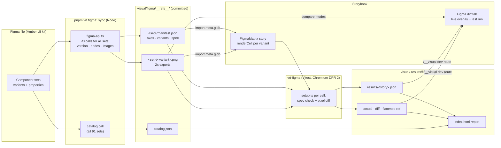
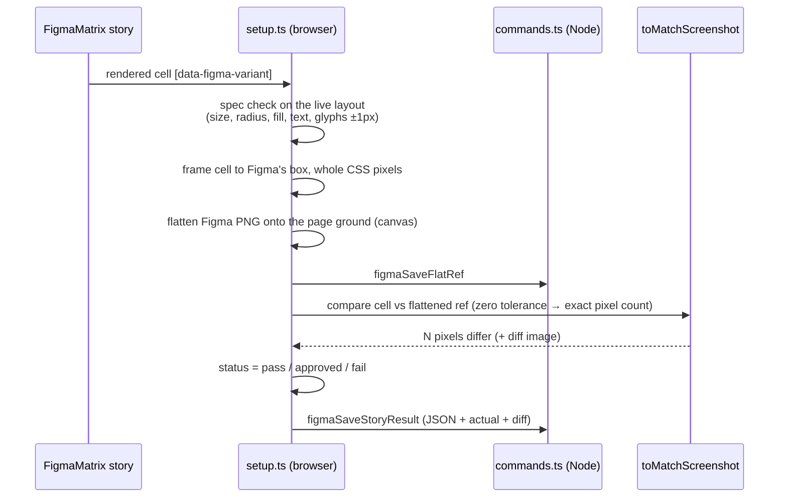
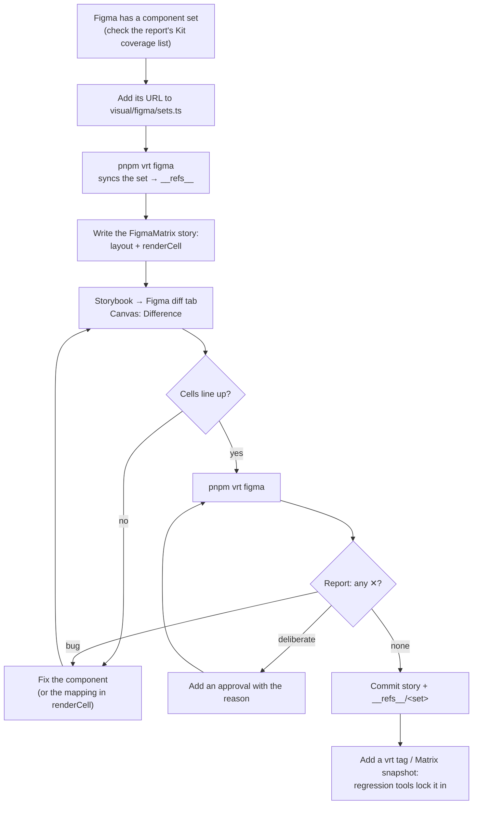
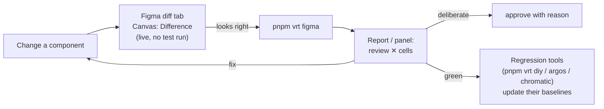
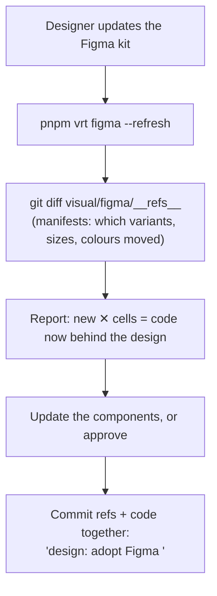

# Figma testing

How the Amber kit is held to its Figma file: the idea, the moving parts, and how to work with it, from a component's first commit to a design change months later.

- **Run**: `pnpm vrt figma` (`--refresh` to pull the latest Figma; `--doctor` to check access and freshness first).
- **Agents**: the `figma-matrix` skill (`.claude/skills/figma-matrix/`) runs this process end to end.
- **Look**: Storybook → any `Figma Matrix` story → **Figma diff** tab; or the report at `visual/.results/figma/index.html`.
- **Add a component**: [Starting a component](#starting-a-component).

## Why this exists

The kit already has three visual regression tools (DIY, Argos, Chromatic; see [README.md](README.md)). They compare **code against earlier code**: they notice when a render changes, not whether it was ever right. The design lives in Figma, and nothing checked the code against it except a person looking at two windows.

Figma testing answers the other question: **does the component look like its design, variant by variant?** Every combination that Figma draws (each size × state × status…) is rendered from code and compared with Figma's own export of that variant.

## Philosophy

1. **Figma is the spec, and it decides the grid.** Variant axes, their options and their order come from the Figma component set (`componentPropertyDefinitions`), not from the code. If Figma draws 18 Button variants, the matrix has 18 cells. A variant the code can't render still gets a cell, marked _no code equivalent_, so gaps are visible instead of silently skipped.
2. **Pixel-perfect is a review aid, not a gate, and text belongs to the spec.** Figma's text renderer is not Chromium's, and Linux Chromium (the pinned Docker browser) even rounds every glyph advance to a whole pixel, so a long label lands 2–3 px wider than Figma's. A zero-tolerance gate always fails; a loose one hides real bugs. So every cell is checked twice, each check owning what it measures well:
    - **Spec (the gate)**: measured geometry and type against Figma's numbers, within 1 px: root size, radius, background, every text run's position, font, size, weight, line height, letter spacing and colour, every glyph's box. Edges that sit after text get a text-advance allowance (0.25 px per character before them), the known glyph-rounding error. These are exact questions with exact answers.
    - **Pixels (the evidence)**: pixelmatch against Figma's 2x PNG with the text boxes masked identically on both sides, so pixels judge fills, strokes, shadows and glyphs, never text rasterisation (5 % tolerance). Produces the diff image a human reviews.
3. **Deviations are decisions, written down.** The code sometimes departs from Figma on purpose: a 48 px hit target where Figma draws 20 px (WCAG 2.5.8), a focus ring Figma never drew (WCAG 2.4.7). Such cells are _approved_ with the reason next to them, in the story, reviewed like code (ADR 0002). They keep being measured, so an approval can't hide a regression in the same cell.
4. **The baseline is pinned.** Figma's exports and specs are committed. A designer editing Figma never flips a test mid-PR; adopting a design change is an explicit `--refresh` commit that shows up in review.
5. **Same pixels as production.** Cells render on the kit's real dark ground (`surface-ground`), at DPR 2, in a pinned Linux Chromium. The kit's colours are translucent white; on any other backdrop they'd look different from what users see. Testing on white once made a Checkbox "match" while its checked state was the wrong colour.
6. **Figma testing finds drift; regression testing keeps it fixed.** Once a component matches Figma, DIY/Argos/Chromatic lock it against accidental change. Figma testing runs when design or component changes, not on every commit.

## How it works



| Piece | File | Role |
| --- | --- | --- |
| Set registry | `visual/figma/sets.ts` | Figma component sets held to code. The runner syncs exactly these. |
| Sync | `visual/figma/figma-api.ts` | Fetches a set's variants, specs and 2x PNGs; the kit catalog. Token read here only. |
| Cache | `visual/figma/__refs__/` | Committed manifests, PNGs, catalog. |
| Matrix component | `visual/figma/FigmaMatrix.tsx` | Lays cells out by Figma's own axes; live compare overlay. |
| Content helper | `visual/figma/content.tsx` | Figma label + glyphs → kit content (`StarFour` → `star-four.svg`). |
| Checks | `visual/figma/setup.ts`, `spec.ts` | Per cell: spec mismatches, pixel diff, status. |
| Results | `visual/.results/figma/` | Per-story JSON, images, report page. |
| Panel | `.storybook/figma-panel.tsx` | "Figma diff" tab. |
| Report | `visual/figma/report.ts` | All matrices + kit coverage on one page. |

### One cell, step by step



### Cell statuses

| Status         | Meaning                                                                    | Fails the run? |
| -------------- | -------------------------------------------------------------------------- | -------------- |
| ✓ **pass**     | Spec within 1 px and pixels within tolerance.                              | No             |
| ✕ **fail**     | Spec mismatch, or pixels over tolerance, or not measurable (size differs). | **Yes**        |
| ≈ **approved** | Would fail, but a recorded deviation covers it; the reason is shown.       | No             |
| ∅ **no code**  | Figma draws it, `renderCell` returned `null`: the code can't express it.   | No             |

## Starting a component

Use this when a component gets a Figma matrix for the first time, typically while porting it.



1. **Find the set.** The report's _Kit coverage_ section lists every component set in the Figma file and whether a matrix covers it. Copy the set's node URL (the component set, not one variant).
2. **Register it** in `visual/figma/sets.ts`, then `pnpm vrt figma` (needs `FIGMA_TOKEN` in `.env.local`, a personal access token with file read scope). The set lands in `visual/figma/__refs__/<file>-<node>/`.
3. **Write the story** in the component's stories file:

```tsx
const FIGMA_BLOCK = { set: FIGMA_SETS.radio, layout: { sections: 'Size', columns: 'State' } };

function figmaRadio(variant: FigmaVariant) {
    const state = FIGMA_STATE[variant.props.State ?? ''] ?? 'default';

    return (
        <RadioGroup className="flex" value={variant.props.Status === 'Selected' ? 'on' : 'off'}>
            <label className="inline-flex">
                <Radio
                    value="on"
                    size={FIGMA_SIZE[variant.props.Size ?? '']}
                    disabled={state === 'disabled'}
                    className={FORCED[state]}
                />
                <span className="sr-only">{variant.name}</span>
            </label>
        </RadioGroup>
    );
}

export const FigmaMatrix = meta.story({
    tags: ['figma', '!autodocs'],
    parameters: { design: { type: 'figma', url: FIGMA_SETS.radio }, figmaMatrix: { blocks: [FIGMA_BLOCK] } },
    render: function FigmaMatrixStory(_args, { globals }) {
        return (
            <FigmaMatrixGrid
                compare={globals[FIGMA_COMPARE_GLOBAL]}
                blocks={[{ ...FIGMA_BLOCK, renderCell: figmaRadio }]}
            />
        );
    },
});
```

`renderCell` rules:

- **Map Figma's values to props** with small lookup tables (`{ Big: 'lg', Medium: 'md', Small: 'sm' }`). Unknown values fall back or return `null`.
- **Use Figma's content.** `figmaContent(variant)` gives the label and the glyphs left and right of it; `<KitIcon figma={…} />` renders the matching kit SVG. Comparing "Save" with Figma's "Generate Automations" measures nothing.
- **Pin pointer states** (hover, pressed, focus) with the story file's `FORCED` classes, the same tokens the component applies. A static capture can't hover.
- **Return `null` for what the code can't express** (a size the types forbid, a Figma state with no prop). Never approximate: a faked cell is a false pass.
- **The cell's first element is what gets measured.** Wrap only what Figma's variant frame contains. A wrapper that adds a line box (a block `RadioGroup`) inflates the measured height; make it `flex`.
- **Keep the story free of `.test()` children.** The check runs after every test of the story, and a test's args change the render.

4. **Look before you run.** In Storybook, open the story's **Figma diff** tab and set _Canvas_ to **Difference**: identical pixels go black, any drift glows. _Onion skin_ and _Side by side_ help find where.
5. **Run, then triage every ✕**: a bug (fix the component), a wrong mapping (fix `renderCell`), or a deliberate deviation (approve it, step 6).
6. **Approve deliberate deviations** on the block, matched by Figma property values:

```ts
approved: [
    {
        when: { State: ['Focused', 'Loading'] },
        reason: 'Figma 9642:177476 draws no focus stroke and no spinner; both added (WCAG 2.4.7; double activation).',
    },
],
```

Name the WCAG criterion or the decision. An approval without a reason is a hidden failure. 7. **Commit** the story and the new `__refs__/<set>` folder together.

### Multi-set components

Some components have one Figma set per code variant (Button: Primary, Secondary, Destructive, Link…, nine sets). Pass one block per set; each block has its own layout, `renderCell` and approvals, and all of them land in one matrix story, one panel and one report section. See `Button.stories.tsx` → `FIGMA_BUTTONS`.

### Choosing a layout

`layout: { sections, columns }` names Figma properties: one block per `sections` option, `columns` across, every other property combined down the side, all in Figma's order. Combinations Figma doesn't draw are dropped, so sparse sets (Badge: 31 of thousands of combinations) stay compact. Put the property people compare across (usually `State`) in `columns` and the coarsest one (`Size`, `Type`) in `sections`.

## During development



- **While editing**, keep the story open with _Canvas: Difference_. The overlay uses the committed Figma PNGs, follows hot reload and needs no test run.
- **Before pushing a UI change**, run `pnpm vrt figma` and read the report: the toolbar's _Diff_ view shows every cell's pixel diff at once, _Highlight failures_ dims everything else.
- **A token change** (colour, spacing, radius) touches many components. Run the whole suite; the report sorts components with failures first.
- **Fix the cause, not the number.** Text is masked from pixels and has its own allowance, so a cell over `maxDiffRatio` is a fill, stroke, shadow or glyph difference: explain it, fix it, or approve it.

## When Figma changes



- `--refresh` re-reads every registered set (one version check + one nodes call) and the catalog. Images are re-downloaded only when the Figma file version changed (the images endpoint is heavily rate-limited).
- The manifest diff is the design change log: new variants, changed sizes, colours, fonts.
- Adopt a design change in one PR: refs, component changes and approval updates together.

## Reviewing a PR

- **Refs changed (`visual/figma/__refs__/`)**: a design update. Check the manifest diff matches what design announced.
- **Story or approvals changed**: every new `approved` entry needs a reason you agree with.
- **Component changed**: ask for the report, or run `pnpm vrt figma` locally; ✕ cells must be zero or explained.

## Reading the results

| Where | What |
| --- | --- |
| **Storybook → Figma diff tab** | _Canvas_: Off, Side by side, Onion skin, Difference, live on the canvas. _Last run_: status grid laid out like the Figma set; pick a cell for its spec mismatches, approval reason and Figma / story / diff / slider views. |
| **Report** (`visual/.results/figma/index.html`, also `/__visual/visual/.results/figma/index.html` on the Storybook dev server) | Every matrix, block by block, failures first. One switch flips all cells between Story / Figma / Diff / Swipe. _Kit coverage_ lists all Figma component sets and which have a matrix. |
| **CLI** | `pnpm vrt figma` prints per-test soft assertions (`Figma spec: …`, `Figma image: … % differ`) and appends a run to `visual/runs.jsonl`. |

Colour mismatch lines print the kit's HSL format with the nearest token on each side, e.g. `root background hsl(240 74.7% 84.5% / 0.102) [= --color-surface-tag-septenary → --color-lavender-alpha-100-10] ≠ Figma hsl(235 69.8% 83.1% / 0.1) [≈ --color-surface-tag-septenary → … (Δ4)]`: same token both sides means the token's value drifted from Figma; different tokens means the component uses the wrong one. Comparison stays in sRGB channels (±3/255); HSL is for reading.

Diff images: red pixels differ, yellow are anti-aliasing differences pixelmatch recognised, magenta boxes are masked text (judged by the spec).

## What's committed

| Path | Committed | Why |
| --- | --- | --- |
| `visual/figma/__refs__/<set>/manifest.json` | Yes | Pinned spec; its diff is the design change log. |
| `visual/figma/__refs__/<set>/*.png` | Yes | Pinned baseline (~3 KB each; 205 PNGs = 1.5 MB). Runs work offline and without a token; no rate limits in CI; the live overlay works for everyone. |
| `visual/figma/__refs__/catalog.json` | Yes | Kit coverage list. |
| `visual/.results/figma/**` | No (`.gitignore`) | Per-run output: actuals, diffs, flattened refs, JSON, report. Upload as a CI artifact instead. |

`.gitattributes` marks the refs `linguist-generated`, so PR diffs collapse them. Images are synced only for registered sets, not all 91 in the kit. If the refs ever grow past a few tens of MB, move the PNGs to Git LFS; don't gitignore them, or the baseline stops being pinned.

## Tolerances and numbers

Measured on the current kit, Docker Chromium (pinned), DPR 2, text masked:

| Component | Pixels differing on matching cells | Notes |
| --- | --- | --- |
| Button (9 sets, 126 Figma variants) | 0–2.2 % | Links approved (hit target), focus/spinner on `primary-on-surface` approved. |
| Checkbox (24) / Radio (24) | 0–3.8 % | No text; the residue is anti-aliased curves. |
| Badge (31) | 0–5.7 % | Failures are spec drift (sizes, fonts, tone tokens), not noise. |

Defaults: spec ±1 px plus 0.25 px per character of text before the edge, ±3/255 per colour channel; pixels 5 % (`figmaMatrix.maxDiffRatio`) with text masked, pixelmatch threshold 0.1.

Why masked text and an advance allowance instead of a pixel-perfect gate: Linux Chromium lays glyphs out on whole pixels while Figma (and macOS) keep fractions. Measured on "Stop Recondition": Figma 121 px, macOS Chromium 120.8 px, Docker Chromium 124 px. No Chromium flag (`--font-render-hinting=none`, subpixel-positioning features) and no fontconfig setting changes it; the allowance is the honest model of that error.

## Configuration reference

```ts
parameters: {
    figmaMatrix: {
        blocks: [
            {
                set: FIGMA_SETS.buttonPrimary,                    // URL from sets.ts
                layout: { sections: 'Size', columns: 'State' },   // Figma property names
                approved: [{ when: { State: ['Focused'] }, reason: '…' }],
            },
        ],
        maxDiffRatio: 0.05,   // per story; share of pixels allowed to differ
        ignore: ['letter-spacing'], // spec lines containing these are dropped (approve instead where possible)
    },
},
```

| Command | Does |
| --- | --- |
| `pnpm vrt figma` | Sync missing sets and the catalog, test every `figma`-tagged story, write the report. |
| `pnpm vrt figma --refresh` | Re-read every registered set and the catalog from Figma first. |
| `pnpm vrt figma --host-browser` | Local Chromium instead of the Docker one (when the container is down). |
| `pnpm vrt figma --doctor` | Readiness check: Figma access, cache vs Figma version, sets without stories, browser, Storybook. Ends on a mode: full / offline / blocked. |
| `pnpm vrt:browser` | Start the pinned Docker Chromium. |

`--update` is refused for `figma`: it would overwrite Figma's PNGs with screenshots.

## Troubleshooting

| Symptom | Cause / fix |
| --- | --- |
| `Figma set … not synced` | Run `pnpm vrt figma` (needs `FIGMA_TOKEN`). |
| `429` from Figma | Images endpoint rate limit. Wait out `Retry-After`; don't loop `--refresh`. |
| `Expected image dimensions … but received …` | The cell's root isn't Figma's box: a wrapper adds size (make it `flex`), or the component really is a different size (the spec check says which). |
| Everything matches at 0.0 % suspiciously | Check the backdrop: colours are translucent; cells must render on the kit ground. |
| `root radius … ≠ Figma 0/0/0/0` but pixels match | Figma paints the box on an inner frame; the sync follows a paint-less root's single same-size child. If a set nests deeper, check its manifest. |
| `icons: N rendered ≠ Figma M` | Glyph count differs: wrong icon mapping, a missing kit SVG (`KitIcon` renders nothing for unknown names), or hidden helper elements. Stacked SVG layers on one box count once; visually hidden inputs are ignored. |
| Panel buttons do nothing | Restart Storybook after config changes (`figmaCompare` is declared in `.storybook/preview.tsx`). |
| `Failed to connect to the browser session` | Docker browser down: `pnpm vrt:browser:stop && pnpm vrt:browser`, or `--host-browser`. |
| Hook timed out | Large matrices capture every cell in one `afterEach`; `hookTimeout` is 300 s in `vitest.config.ts`. |

## Limits

- **Boolean properties** (`Show Left Icon`) can't be axes: Figma renders only their defaults.
- **Animations** (spinners) are frozen at frame 0 in the story; Figma draws an arbitrary frame. Expect a few percent there.
- **Pointer states** are pinned with classes, not real hover/focus. If a component's real hover differs from its `FORCED` pin, the matrix can't see it; the behaviour tests (`story.test`) cover interaction.
- **Text rendering** differs between Figma and Chromium (and between Linux and macOS Chromium). Text is therefore masked from the pixel comparison and checked by spec value with a text-advance allowance; a wrong glyph shape inside a label (a different font with identical metrics) is out of reach.
- **Figma API**: the images endpoint is Tier 1 and rate-limits aggressively. See [Sync cost](#sync-cost).

## Sync cost

The sync batches by Figma file, not by set, and pins every call to one file version so a snapshot is consistent:

| Case | Figma calls | Time (12 sets, 205 variants) |
| --- | --- | --- |
| Everything cached (`pnpm vrt figma`) | 0 | instant |
| `--refresh`, Figma unchanged | 2 (version check, nodes) | ~4.5 s |
| Cold sync or Figma changed | 3 (version check, nodes, one images call for every variant) | ~9 s |

PNGs download from Figma's CDN 8 at a time (not rate-limited); exports are byte-identical between syncs of the same version. A 429 with `Retry-After` ≤ 60 s is retried once; a longer one is reported, not waited out. Rendering one sheet per set and cropping locally would save renders but risks sub-pixel crop drift, so each variant is exported on its own.
